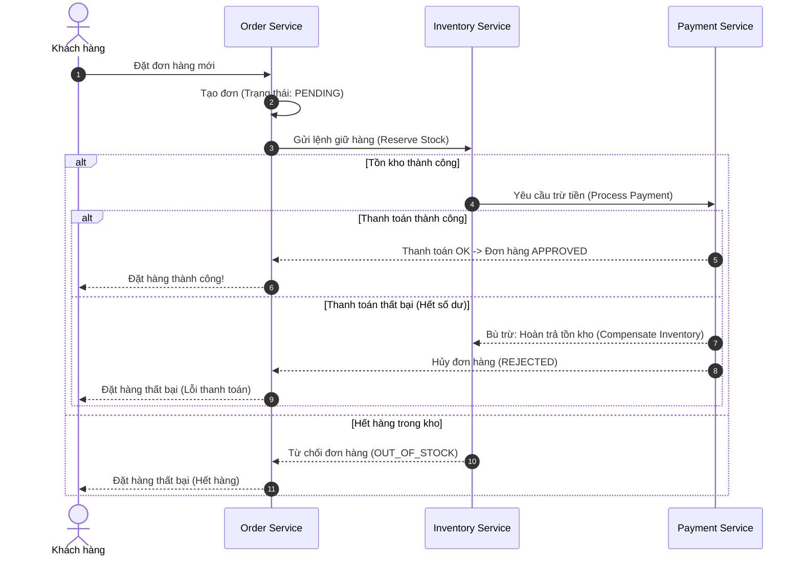

# BÁO CÁO NGHIÊN CỨU CHUYÊN SÂU: KIẾN TRÚC MICROSERVICES VÀ ỨNG DỤNG TRONG PHÁT TRIỂN HỆ THỐNG HIỆN ĐẠI

---

> **Môn học:** Kiến trúc Phần mềm & Phát triển Hệ thống Phân tán  
> **Chủ đề:** Phân tích Chuyên sâu Kiến trúc Microservices (Microservices Architecture)  
> **Định dạng:** Báo cáo kỹ thuật 5 phần (tương đương 5 trang chuẩn học thuật)  
> **Ngày lập:** Tháng 11/2026  

---

<div style="page-break-after: always;"></div>

## TRANG 1: TỔNG QUAN, BỐI CẢNH VÀ NGUYÊN LÝ CỐT LÕI

### 1. Tóm tắt điều hành (Executive Summary)
Trong kỷ nguyên điện toán đám mây (Cloud Computing) và yêu cầu vận hành với quy mô hàng triệu người dùng đồng thời, kiến trúc nguyên khối truyền thống (Monolithic Architecture) bộc lộ nhiều điểm nghẽn nghiêm trọng về khả năng mở rộng, tính sẵn sàng và tốc độ phát hành tính năng. Kiến trúc vi dịch vụ (Microservices Architecture) nổi lên như một mô hình chuẩn mực giúp giải quyết các thách thức này bằng cách chia nhỏ ứng dụng lớn thành một tập hợp các dịch vụ nhỏ, độc lập, có phạm vi nghiệp vụ hẹp, giao tiếp với nhau qua các giao thức mạng nhẹ. Báo cáo này nghiên cứu toàn diện từ nền tảng lý thuyết, cơ chế kỹ thuật, quản lý dữ liệu phân tán, mô hình triển khai DevOps/Kubernetes cho đến đánh giá thực tiễn và xu hướng tương lai.

```
       KIẾN TRÚC MONOLITHIC                       KIẾN TRÚC MICROSERVICES
+-----------------------------------+     +-------------+    +-------------+
|         Giao diện người dùng      |     |  Dịch vụ A  |    |  Dịch vụ B  |
+-----------------------------------+     |  (User DB)  |    | (Order DB)  |
| Nghiệp vụ A | Nghiệp vụ B | ...   |     +------+------+    +------+------+
+-----------------------------------+            \                 /
|    Một cơ sở dữ liệu duy nhất     |             \  API Gateway  /
+-----------------------------------+              +------+------+
                                                          |
                                                    Client Request
```

### 2. Bối cảnh lịch sử và Sự dịch chuyển từ Monolith sang Microservices
* **Hạn chế của kiến trúc Monolith:**
  * **Khó khăn trong mở rộng (Scalability):** Muốn mở rộng một module ngốn tài nguyên (như xử lý ảnh hay thanh toán), toàn bộ ứng dụng nguyên khối phải được nhân bản, gây lãng phí CPU/RAM nghiêm trọng.
  * **Rủi ro phụ thuộc (Tight Coupling):** Một lỗi rò rỉ bộ nhớ (memory leak) hoặc crash tại một module phụ có thể đánh sập toàn bộ hệ thống (Single Point of Failure).
  * **Rào cản công nghệ:** Ràng buộc toàn bộ đội ngũ kỹ thuật vào một ngôn ngữ và framework duy nhất, khó thử nghiệm công nghệ mới.
  * **Chậm trễ trong quy trình Release:** Đội ngũ phát triển đông đảo dẫn đến xung đột mã nguồn (merge conflicts), quy trình kiểm thử hồi quy kéo dài, làm giảm tính linh hoạt (Agility).

### 3. Định nghĩa và 9 Đặc trưng Cốt lõi của Microservices
Theo định nghĩa kinh điển của Martin Fowler và James Lewis: *“Kiến trúc vi dịch vụ là một phương pháp tiếp cận để phát triển một ứng dụng đơn lẻ dưới dạng một bộ dịch vụ nhỏ, mỗi dịch vụ chạy trong tiến trình riêng của nó và giao tiếp bằng cơ chế nhẹ, thường là HTTP resource API.”*

Hệ thống Microservices tiêu chuẩn tuân thủ 9 đặc trưng cốt lõi:
1. **Phân rã theo Năng lực Nghiệp vụ (Componentization via Services):** Thiết kế dịch vụ xoay quanh ranh giới nghiệp vụ (Business Capabilities) thay vì tầng kỹ thuật (UI, Business Logic, DB). Áp dụng chặt chẽ phương pháp Thiết kế Hướng miền (**Domain-Driven Design - DDD**) và khái niệm **Bounded Context**.
2. **Tổ chức theo Đội ngũ Chức năng chéo (Organized around Business Capabilities):** Tuân thủ định luật Conway (*Conway's Law*), tổ chức nhóm đa năng (Full-stack teams) sở hữu trọn vòng đời dịch vụ: *"You build it, you run it"*.
3. **Sản phẩm chứ không phải Dự án (Products not Projects):** Chuyển từ tư duy hoàn thành dự án sang quản trị vòng đời sản phẩm liên tục.
4. **Điểm cuối Thông minh, Ống dẫn Đơn giản (Smart Endpoints and Dumb Pipes):** Logic nghiệp vụ nằm hoàn toàn ở hai đầu dịch vụ; hệ thống truyền tin (như RabbitMQ, Kafka) chỉ đóng vai trò chuyển tiếp dữ liệu thuần túy, tránh nhúng logic vào bus trung gian như kiến trúc SOA/ESB cũ.
5. **Phân tán Quyền quản trị (Decentralized Governance):** Mỗi nhóm có quyền tự do lựa chọn ngôn ngữ (Polyglot Programming - Go, Java, Node.js, Python) phù hợp nhất với bài toán cụ thể.
6. **Phân tán Quản lý Dữ liệu (Decentralized Data Management):** Mỗi microservice nắm giữ cơ sở dữ liệu riêng biệt (**Database-per-Service**), cấm truy cập chéo trực tiếp ở tầng dữ liệu.
7. **Tự động hóa Cơ sở Hạ tầng (Infrastructure Automation):** Tận dụng triệt để CI/CD, Containerization và Infrastructure as Code (IaC) để kiểm thử và triển khai liên tục.
8. **Thiết kế Chống Lỗi (Design for Failure):** Hệ thống phải luôn dự phòng tình huống một hoặc nhiều dịch vụ gặp sự cố đột ngột mà không gây sụp đổ dây chuyền (Cascading Failure).
9. **Thiết kế Tiến hóa (Evolutionary Design):** Các dịch vụ có thể được tái cấu trúc, nâng cấp hoặc thay thế độc lập mà không ảnh hưởng tới toàn cục.

---

<div style="page-break-after: always;"></div>

## TRANG 2: THÀNH PHẦN KIẾN TRÚC VÀ CƠ CHẾ GIAO TIẾP (COMMUNICATION PATTERNS)

### 4. Các Thành phần Cơ bản trong Hệ sinh thái Microservices

Một hệ thống microservices vận hành trong môi trường production luôn bao gồm các tầng hỗ trợ cốt lõi:

```mermaid
flowchart TD
    Client["Client (Web / Mobile App)"] -->|HTTPS / WSS| APIGW["API Gateway (Kong / Spring Cloud Gateway / Envoy)"]
    
    subgraph ServiceMesh ["Hệ sinh thái Microservices"]
        APIGW -->|Route / Auth / Rate Limit| SvcA["Order Service"]
        APIGW -->|Route / Auth / Rate Limit| SvcB["Payment Service"]
        APIGW -->|Route / Auth / Rate Limit| SvcC["Inventory Service"]
        
        SvcA <-->|gRPC (Sync)| SvcB
        SvcA -->|Publish Event| MQ[("Message Broker (Kafka / RabbitMQ)")]
        MQ -->|Consume Event| SvcC
        
        SR[("Service Registry & Discovery\n(Consul / Eureka)")] -.-> SvcA
        SR -.-> SvcB
        SR -.-> SvcC
        
        CS[("Config Server\n(Spring Config / Vault)")] -.-> SvcA
        CS -.-> SvcB
    end
```

* **API Gateway:** Điểm tiếp nhận duy nhất cho toàn bộ yêu cầu từ client. Đảm nhận các tác vụ: Định tuyến (Routing), Xác thực & Phân quyền (Authentication & Authorization - JWT, OAuth2), Giới hạn tốc độ truy cập (Rate Limiting), Tổng hợp dữ liệu (Request Aggregation) và SSL Termination.
* **Service Registry & Discovery:** Cơ chế động giúp các dịch vụ tìm thấy nhau khi IP/Port thay đổi liên tục trong môi trường container (Client-side Discovery như Eureka hoặc Server-side Discovery qua Kubernetes CoreDNS).
* **Distributed Configuration Server:** Lưu trữ tập trung các cấu hình theo môi trường (Dev, Staging, Prod), hỗ trợ cập nhật cấu hình theo thời gian thực (Hot-reload) mà không cần build lại mã nguồn.
* **Circuit Breaker:** Ngắt kết nối tạm thời đến một dịch vụ đang lỗi để bảo vệ hệ thống không bị cạn kiệt tài nguyên (sử dụng thư viện như Resilience4j).

### 5. Cơ chế Giao tiếp giữa các Dịch vụ (Inter-Service Communication)

Giao tiếp trong microservices được phân loại thành hai hình thức chính:

#### 5.1. Giao tiếp Đồng bộ (Synchronous Communication)
Client gửi yêu cầu và chặn tiến trình (blocking) cho đến khi nhận được phản hồi.
* **RESTful API over HTTP/1.1 or HTTP/2:**
  * *Ưu điểm:* Tiêu chuẩn phổ quát, dễ debug, định dạng JSON thân thiện với lập trình viên.
  * *Nhược điểm:* Payload lớn (text-based overhead), độ trễ tương đối cao, kết nối hướng đơn (half-duplex).
* **gRPC over HTTP/2 (Protocol Buffers):**
  * *Ưu điểm:* Mã hóa nhị phân (Binary Serialization) siêu nhẹ, hiệu năng cao gấp 5 - 10 lần REST, định kiểu dữ liệu chặt chẽ qua file `.proto`, hỗ trợ Streaming 2 chiều (Bidirectional Streaming). Thích hợp nhất cho giao tiếp nội bộ (Service-to-Service East-West traffic).
* **GraphQL:** Phù hợp cho API Gateway tổng hợp dữ liệu từ nhiều dịch vụ phía sau để tránh vấn đề Over-fetching và Under-fetching cho ứng dụng Frontend.

#### 5.2. Giao tiếp Bất đồng bộ (Asynchronous / Event-Driven Communication)
Dịch vụ gửi thông điệp và tiếp tục xử lý mà không chờ phản hồi ngay (Non-blocking).
* **Message Broker (RabbitMQ, Apache Kafka):**
  * **RabbitMQ:** Hướng hàng đợi thông điệp (Message-oriented), hỗ trợ định tuyến phức tạp (Routing keys, Topic exchange), đảm bảo chuyển giao tin cậy (acknowledgment).
  * **Apache Kafka:** Nền tảng phân tán theo mô hình Log (Distributed Commit Log), khả năng xử lý thông lượng cực lớn (hàng triệu messages/giây), lưu trữ thông điệp theo thời gian (Event Retention), hỗ trợ phát lại sự kiện (Replayability).
* **Mẫu hình Publish-Subscribe:** Giúp các dịch vụ hoàn toàn tách biệt (Decoupled). Ví dụ: `Order Service` hoàn tất đơn hàng sẽ bắn sự kiện `OrderCreatedEvent`, cả `Payment Service`, `Inventory Service` và `Notification Service` cùng lắng nghe và xử lý độc lập.

---

<div style="page-break-after: always;"></div>

## TRANG 3: QUẢN LÝ DỮ LIỆU PHÂN TÁN VÀ TÍNH NHẤT QUÁN (DISTRIBUTED DATA)

### 6. Chiến lược Quản lý Dữ liệu: Database-per-Service
Trong kiến trúc nguyên khối, việc sử dụng các mệnh đề JOIN và Transaction ACID của cơ sở dữ liệu quan hệ (RDBMS) diễn ra dễ dàng. Tuy nhiên, trong Microservices, nguyên tắc bắt buộc là mỗi dịch vụ phải sở hữu nguồn dữ liệu riêng:

| Tiêu chí | Shared Database (Dùng chung) | Database-per-Service (Dịch vụ độc lập) |
| :--- | :--- | :--- |
| **Tính độc lập** | Thấp - Thay đổi schema bảng dễ làm lỗi các dịch vụ khác | Tuyệt đối - Mỗi dịch vụ toàn quyền kiểm soát cấu trúc dữ liệu |
| **Lựa chọn công nghệ** | Bị gò bó vào 1 loại CSDL duy nhất | Hỗ trợ **Polyglot Persistence** (SQL, NoSQL, Cache, Graph DB) |
| **Khả năng mở rộng** | Điểm nghẽn ở nút thắt Database trung tâm | Mở rộng theo từng dịch vụ, tối ưu hóa theo tải đọc/ghi |
| **Tính toàn vẹn dữ liệu** | ACID cấp cơ sở dữ liệu | Cần cơ chế giao dịch phân tán (**Saga, Eventual Consistency**) |

### 7. Xử lý Giao dịch Phân tán: Từ 2PC sang Saga Pattern
Khi một thao tác nghiệp vụ cần cập nhật dữ liệu trên nhiều microservice độc lập (ví dụ: Tạo đơn hàng $\rightarrow$ Trừ tồn kho $\rightarrow$ Thanh toán ví tiền):
* **Hạn chế của Two-Phase Commit (2PC):** 2PC dựa trên khóa tài nguyên phân tán (Distributed Lock). Khi số lượng dịch vụ tăng, độ trễ mạng khiến tài nguyên bị khóa quá lâu, khả năng sẵn sàng (Availability) giảm sút nghiêm trọng, vi phạm định lý CAP.
* **Mô hình Saga (Saga Pattern):** Chuỗi các giao dịch cục bộ (Local Transactions). Mỗi bước thực hiện xong sẽ phát sinh sự kiện để kích hoạt bước tiếp theo. Nếu một bước thất bại, Saga sẽ kích hoạt chuỗi **Giao dịch bù trừ (Compensating Transactions)** để hoàn tác trạng thái trước đó.



* **Hai cách triển khai Saga:**
  1. **Choreography (Biên đạo múa):** Các dịch vụ tự trao đổi sự kiện trực tiếp không qua người điều phối. Đơn giản với quy trình ít bước, nhưng dễ trở nên rối rắm khi hệ thống phức tạp.
  2. **Orchestration (Nhạc trưởng điều phối):** Một dịch vụ đóng vai trò Saga Orchestrator quản lý máy trạng thái (State Machine), ra lệnh cho từng dịch vụ và xử lý logic bù trừ tập trung.

### 8. Định lý CAP và Các Mẫu Thiết kế Dữ liệu Tiên tiến
* **Định lý CAP (Consistency, Availability, Partition Tolerance):** Trong hệ thống mạng phân tán, sự cố đứt gãy mạng (Network Partition - **P**) là bất khả kháng. Hệ thống buộc phải đánh đổi giữa tính nhất quán tuyệt đối (**C**) hoặc tính sẵn sàng liên tục (**A**). Microservices hầu hết ưu tiên mô hình **AP**, chấp nhận **Tính nhất quán cuối cùng (Eventual Consistency)** thông qua mô hình BASE (Basically Available, Soft state, Eventual consistency).
* **CQRS (Command Query Responsibility Segregation):** Tách biệt đường dẫn Ghi (Command - Insert/Update/Delete) và đường dẫn Đọc (Query). Giúp tối ưu hóa hiệu năng đọc dữ liệu phức tạp bằng các View Database được đồng bộ hóa qua sự kiện.
* **Event Sourcing:** Thay vì lưu trạng thái hiện tại của thực thể, hệ thống lưu lại toàn bộ chuỗi sự kiện thay đổi trạng thái (Append-only Event Log). Cho phép truy vết lịch sử kiểm toán (Audit Log) hoàn hảo và tái tạo trạng thái ở bất kỳ thời điểm nào trong quá khứ.

---

<div style="page-break-after: always;"></div>

## TRANG 4: TRIỂN KHAI, VẬN HÀNH VÀ GIÁM SÁT (DEVOPS & OBSERVABILITY)

### 9. Hạ tầng Đóng gói và Điều phối: Docker & Kubernetes (K8s)
Do hệ thống microservices bao gồm hàng chục hoặc hàng trăm tiến trình độc lập, việc quản lý và vận hành thủ công trên các máy chủ vật lý hay máy ảo truyền thống là bất khả thi.

* **Containerization (Docker):** Đóng gói toàn bộ mã nguồn, runtime, thư viện và biến môi trường vào một Image bất biến (Immutable Artifact), bảo đảm tính nhất quán trên môi trường phát triển (Dev) và sản xuất (Production).
* **Orchestration (Kubernetes):** Đóng vai trò hạt nhân trong việc tự động hóa:
  * **Tự phục hồi (Self-healing):** Khởi động lại các container bị lỗi hoặc chuyển pod sang node khỏe mạnh khi xảy ra sự cố phần cứng.
  * **Tự động mở rộng (Autoscaling):** Horizontal Pod Autoscaler (HPA) tự động tăng giảm số lượng bản sao pod dựa trên mức sử dụng CPU/Memory hoặc Custom Metrics (ví dụ độ dài hàng đợi Kafka).
  * **Cân bằng tải và Khám phá dịch vụ (Load Balancing & Ingress):** Điều phối lưu lượng nội bộ qua K8s Services và tiếp nhận traffic bên ngoài qua K8s Ingress Controller.

```yaml
# Ví dụ triển khai 1 Microservice trên Kubernetes với Health Check và Resource Limits
apiVersion: apps/v1
kind: Deployment
metadata:
  name: order-service
spec:
  replicas: 3
  selector:
    matchLabels:
      app: order-service
  template:
    metadata:
      labels:
        app: order-service
    spec:
      containers:
      - name: order-service
        image: registry.company.com/order-service:v2.1.0
        ports:
        - containerPort: 8080
        resources:
          limits:
            cpu: "1000m"
            memory: "512Mi"
          requests:
            cpu: "250m"
            memory: "256Mi"
        livenessProbe:
          httpGet:
            path: /actuator/health/liveness
            port: 8080
          initialDelaySeconds: 30
          periodSeconds: 10
        readinessProbe:
          httpGet:
            path: /actuator/health/readiness
            port: 8080
          initialDelaySeconds: 15
          periodSeconds: 5
```

### 10. Service Mesh: Tách biệt Mạng lưới và Nghiệp vụ
Khi số lượng dịch vụ bùng nổ, việc nhúng mã nguồn xử lý mTLS, retry, timeout, tracing vào từng dịch vụ gây trùng lặp và khó bảo trì. **Service Mesh** (như Istio, Linkerd) giải quyết vấn đề này bằng mô hình **Sidecar Proxy** (Envoy) đặt cạnh mỗi ứng dụng:
* **Bảo mật không tin cậy (Zero Trust Security):** Tự động mã hóa lưu lượng giữa các dịch vụ bằng **Mutual TLS (mTLS)** mà không cần sửa code ứng dụng.
* **Điều phối lưu lượng nâng cao (Traffic Management):** Hỗ trợ kỹ thuật triển khai tiên tiến như Canary Deployment, Blue/Green Deployment, A/B Testing, Fault Injection (kiểm thử khả năng chịu lỗi).

### 11. Trụ cột Giám sát Toàn diện (The Three Pillars of Observability)

```
                       TRỤ CỘT OBSERVABILITY
           /                     |                     \
          /                      |                      \
    [ METRICS ]             [ LOGGING ]             [ TRACING ]
(Prometheus/Grafana)         (ELK / EFK)       (OpenTelemetry/Jaeger)
Định lượng trạng thái:    Ghi vết chi tiết:     Hành trình yêu cầu:
CPU, RAM, RPS, P99 Latency   Lỗi, ngữ cảnh, Stacktrace   Trace ID xuyên suốt các dịch vụ
```

1. **Distributed Tracing (Truy vết phân tán):** Khi một request từ người dùng đi qua 10 microservices khác nhau, việc tìm ra dịch vụ gây trễ hoặc lỗi đòi hỏi phải có **Trace ID** và **Span ID** được truyền qua HTTP Headers (theo chuẩn W3C Trace Context). Các công cụ như **OpenTelemetry, Jaeger, Zipkin** vẽ biểu đồ thác nước (Waterfall diagram) thể hiện chính xác thời gian xử lý của từng chặng.
2. **Centralized Logging (Nhật ký tập trung):** Tích hợp giải pháp ELK (Elasticsearch, Logstash, Kibana) hoặc Grafana Loki. Dịch vụ chỉ việc xuất log ra stdout dưới dạng JSON chuẩn hóa, các daemon (Filebeat, Fluentbit) sẽ thu thập và gửi về kho lưu trữ tập trung để tìm kiếm nhanh theo Trace ID.
3. **Metrics & Alerting (Chỉ số và Cảnh báo):** Thu thập định kỳ các thông số về hiệu năng ứng dụng (RPS, Error Rate, Latency P50/P90/P99) qua **Prometheus** và trực quan hóa sinh động trên **Grafana**, kết hợp thiết lập cảnh báo tự động tới Slack/PagerDuty.

---

<div style="page-break-after: always;"></div>

## TRANG 5: ĐÁNH GIÁ THỰC TIỄN, THÁCH THỨC VÀ XU HƯỚNG TƯƠNG LAI

### 12. Bảng So sánh Chuyên sâu Các Mô hình Kiến trúc

| Tiêu chí so sánh | Monolithic Architecture | Service-Oriented (SOA) | Microservices Architecture | Serverless (FaaS) |
| :--- | :--- | :--- | :--- | :--- |
| **Kích thước thành phần** | Một khối phần mềm duy nhất | Dịch vụ quy mô doanh nghiệp lớn | Dịch vụ nhỏ, phạm vi nghiệp vụ hẹp | Hàm đơn lẻ (Single-purpose function) |
| **Mức độ phụ thuộc** | Gắn kết chặt chẽ (Tight) | Phụ thuộc vào ESB trung tâm | Độc lập, phân tán cao (Loose) | Độc lập hoàn toàn theo sự kiện |
| **Giao thức liên lạc** | Gọi hàm nội bộ trong bộ nhớ | SOAP, XML, ESB nặng nề | REST, gRPC, Event-driven | HTTP Triggers, Event bindings |
| **Mô hình Dữ liệu** | Một cơ sở dữ liệu dùng chung | Thường dùng chung CSDL | Database-per-Service | Dữ liệu phi trạng thái (Stateless/BaaS) |
| **Tốc độ Triển khai** | Chậm, rủi ro cao khi release | Trung bình | Rất nhanh, độc lập từng service | Ngay lập tức (Instant deployment) |
| **Độ phức tạp vận hành** | Thấp nhất | Cao | Rất cao (Cần K8s, Observability) | Thấp ở hạ tầng, cao ở quản trị luồng |
| **Chi phí ban đầu** | Thấp | Rất đắt (Bản quyền ESB) | Cao (Đầu tư hạ tầng & kỹ sư) | Trả theo lượt gọi (Pay-per-use) |

### 13. Phân tích Thách thức và Các Ảo tưởng về Hệ thống Phân tán
Mặc dù mang lại nhiều lợi thế vượt trội, Microservices đi kèm với cái giá đắt về độ phức tạp kỹ thuật. Theo phân tích về *8 Ảo tưởng của Điện toán Phân tán (Fallacies of Distributed Computing)* của L. Peter Deutsch:
1. **Độ trễ mạng (Network Latency):** Không có cuộc gọi mạng nào có tốc độ bằng 0. Việc phân rã quá mức (Nano-services) sẽ biến chi phí gọi mạng thành nút thắt cổ chai làm chậm hệ thống.
2. **Mạng lưới không đáng tin cậy (Network Reliability):** Rớt gói tin, timeout, partition mạng là quy luật bình thường, đòi hỏi lập trình viên phải xử lý retry có tính toán (Exponential Backoff with Jitter) và Idempotency (tính lũy thừa).
3. **Chi phí vận hành & Nhân sự:** Đòi hỏi đội ngũ kỹ sư phải am hiểu sâu sắc về văn hóa DevOps, CI/CD tự động, hạ tầng đám mây và kỹ năng debug hệ thống phân tán.
4. **Vấn đề bảo mật bề mặt rộng (Attack Surface):** Khi mở rộng thành hàng chục dịch vụ, ranh giới bảo mật mạng bị phân mảnh, đòi hỏi cơ chế xác thực đầu-cuối (End-to-End Zero Trust) nghiêm ngặt.

### 14. Chiến lược Chuyển đổi và Khuyến nghị Thực tiễn

#### 14.1. Mẫu hình Chuyển đổi Strangler Fig (Strangler Fig Pattern)
Tuyệt đối tránh phương pháp tiếp cận "Đập đi xây lại từ đầu" (Big Bang Rewrite). Phương pháp an toàn và hiệu quả nhất là **Strangler Fig Pattern**:
1. Đặt một API Gateway phía trước hệ thống Monolith hiện hữu.
2. Trích xuất từng module nghiệp vụ độc lập nhỏ (ví dụ: Module gửi thông báo hoặc Quản lý bình luận) sang Microservice mới.
3. Cấu hình Gateway chuyển hướng lưu lượng dần dần sang dịch vụ mới.
4. Lặp lại chu trình cho đến khi toàn bộ khối Monolith cũ co nhỏ lại và ngừng hoạt động hoàn toàn.

```
Giai đoạn 1: [Gateway] ---> Toàn bộ traffic vào [Monolith]
Giai đoạn 2: [Gateway] ---> 90% vào [Monolith] | 10% vào [New Microservice A]
Giai đoạn 3: [Gateway] ---> Chuyển dần các nghiệp vụ B, C...
Giai đoạn 4: [Monolith cũ bị khai tử hoàn toàn]
```

#### 14.2. Khi nào NÊN và KHÔNG NÊN chọn Microservices?
* **NÊN CHỌN khi:**
  * Hệ thống đã đạt quy mô lớn, có sự tăng trưởng bùng nổ về tính năng và lưu lượng truy cập.
  * Doanh nghiệp sở hữu nhiều nhóm phát triển (từ vài chục đến hàng trăm kỹ sư) cần làm việc song song độc lập.
  * Ranh giới các miền nghiệp vụ (Domain Boundaries) đã rõ ràng và ổn định.
* **KHÔNG NÊN CHỌN khi:**
  * Dự án Startup giai đoạn khởi tạo (MVP - Minimum Viable Product), mô hình nghiệp vụ thay đổi hàng tuần.
  * Đội ngũ nhỏ (dưới 5 - 10 người), nguồn lực tài chính và hạ tầng DevOps còn hạn chế.
  * Nghiệp vụ đơn giản, tải thấp; một kiến trúc **Modular Monolith** là sự lựa chọn vượt trội hơn nhiều về mặt chi phí và tốc độ phát triển.

### 15. Xu hướng Phát triển Tương lai (Future Trends)
1. **Serverless Microservices:** Kết hợp sự linh hoạt của Microservices với tính chất không máy chủ (AWS Lambda, Google Cloud Run), tự động scale từ 0 về 0 giúp tiết kiệm chi phí tối đa.
2. **WebAssembly (Wasm) trên Server-side:** Wasm cho phép chạy các module vi dịch vụ với tốc độ khởi động tính bằng mili-giây và mức tiêu thụ bộ nhớ chỉ vài megabyte, vượt trội hơn container Docker truyền thống.
3. **AI-driven Observability (AIOps):** Ứng dụng trí tuệ nhân tạo để tự động phát hiện dị thường trong log/metrics, dự đoán sự cố trước khi xảy ra và tự động định tuyến phục hồi hệ thống.

---

### TÀI LIỆU THAM KHẢO CHÍNH (REFERENCES)
1. Martin Fowler & James Lewis (2014), *Microservices: a definition of this new architectural term*, martinfowler.com.
2. Sam Newman (2021), *Building Microservices: Designing Fine-Grained Systems (2nd Edition)*, O'Reilly Media.
3. Chris Richardson (2018), *Microservices Patterns: With examples in Java*, Manning Publications.
4. Eric Evans (2003), *Domain-Driven Design: Tackling Complexity in the Heart of Software*, Addison-Wesley.
5. Google Cloud Architecture Center, *Microservices architecture on Google Cloud*.

